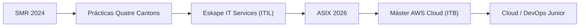

# Brian Tarira
### ☁️ Cloud & Systems Engineer Junior · DevOps Junior (AWS)

📍 Barcelona · Mollet del Vallès &nbsp;|&nbsp; 🗣️ ES · CAT · EN (B2)

[💼 LinkedIn](https://www.linkedin.com/in/brian-tarira) · [✉️ Email](mailto:briandouglas795@gmail.com) · [📄 CV (PDF)](docs/CV_Brian_Tarira_ES.pdf) · [🌐 Portafolio web](https://briantarira7ea.github.io/CV-Portafolio/)

---

## 👋 Sobre mí
Técnico de sistemas con experiencia real en producción en una consultora IT bajo **ITIL**, especializándome en **AWS Cloud Computing** en el Institut Tecnològic de Barcelona (ITB). Me gusta automatizar lo repetitivo, documentar bien y dejar la infraestructura más ordenada de como la encontré.

🇬🇧 English summary

Junior Cloud & Systems Engineer with hands-on production experience at an ITIL-based IT consultancy, completing a Specialisation Master's in AWS Cloud Computing at Institut ITB. I enjoy automating repetitive work, documenting clearly and leaving infrastructure tidier than I found it. Looking for a Junior Cloud / DevOps role and an Erasmus+ traineeship in Europe.

## 🧭 Mi recorrido

## 🛠️ Stack técnico
| Área | Tecnologías |
|---|---|
| ☁️ **Cloud & DevOps** | AWS (EC2, S3, IAM, Route 53) · Azure / Entra ID · Docker · Docker Compose · Kubernetes (básico) · Git · CI/CD · Nginx |
| 🖥️ **Sistemas** | Linux (Debian, Ubuntu, CentOS) · Windows Server 2019/22 · Active Directory · VMware vSphere · Proxmox · Hyper-V · Citrix |
| ⚙️ **Automatización** | Bash · PowerShell |
| 🔐 **Redes y seguridad** | TCP/IP · DNS · DHCP · VLANs · VPN IPsec · Cloudflare (WAF/CDN) · Microsoft Defender |
| 🗄️ **Datos y gestión** | SQL · MySQL · PostgreSQL (PL/pgSQL) · ITIL v4 (fundamentos) · Jira |

## 💼 Experiencia
| Periodo | Rol | Lo más destacado |
|---|---|---|
| **Jun–Ago 2026** | Técnico de instalaciones de cámaras de seguridad · *Tecnocat Seguretat* | Instalación y programación de cámaras de seguridad; trabajo con extintores |
| **Oct 2025 – Jul 2026** | Técnico de Sistemas / Service Desk IT Junior · *Eskape IT Services* | +40 tickets/mes (L1/L2) bajo ITIL · AD, Entra ID, Intune, M365 · scripts PowerShell/Bash que redujeron **>60 %** el trabajo manual · Defender, VPN IPsec, VLANs, migraciones P2V en vSphere |
| **Ene–Jun 2024** | Prácticas de Sistemas Microinformáticos · *Quatre Cantons* | Soporte a +200 equipos Windows/Linux · diagnóstico LAN · scripts de backup · documentación técnica |
| **2023–2025** | Atención al cliente · *Consum, La Tagliatella, restaurante en Sants* | Trabajo en equipo, presión y adaptabilidad |

## 🚀 Proyectos y competiciones
- 🏆 **AWS Jam** — competición oficial de AWS resolviendo retos de infraestructura en tiempo real.
- 🏁 **Hackathon Cloud Computing (Valencia)** — competición inter-centros de infraestructura cloud.
- 🍽️ **[Restobar Alex](https://restobaralex.github.io/menu-restobar-alex)** — web real en producción para un restaurante: responsive, SEO, GitHub Pages.
- 🧪 **Labs Cloud / SysAdmin** — Docker, Linux y Windows Server, Active Directory y scripts de automatización.

## 🚧 En construcción
| Repo | Qué es | Estado |
|---|---|---|
| `aws-terraform-infra` | Infraestructura como código en AWS con Terraform: VPC, EC2, S3 e IAM | 🔨 En desarrollo |
| `devops-cicd-pipeline` | Pipeline CI/CD con GitHub Actions: build de imagen Docker y despliegue | 📝 Planificado |

## 🎓 Formación
- **Máster de Especialización en AWS Cloud Computing** · Institut Tecnològic de Barcelona (ITB) · *en curso*
- **CFGS ASIX** · Institut TIC Barcelona · 2026
- **CFGM SMR** · Institut TIC Barcelona · 2024

## 📫 Contacto
💼 [linkedin.com/in/brian-tarira](https://www.linkedin.com/in/brian-tarira) · ✉️ briandouglas795@gmail.com · 🐙 [github.com/briantarira7ea](https://github.com/briantarira7ea)

Hecho con ☕, scripts y mucha documentación.

